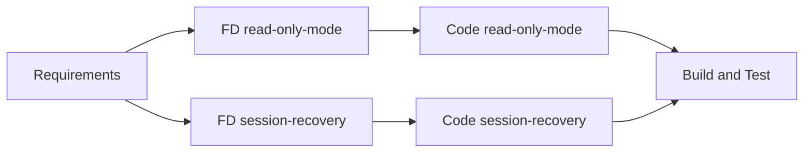

# Execution Plan - Read-Only Mode + Stale-Session Recovery

Mode: autonomous (Q11 B). Stage decisions are self-approved and logged in audit.md.

## Stage Decisions

| Stage | Decision | Rationale |
|---|---|---|
| Workspace Detection | Done | Brownfield, existing artifacts |
| Reverse Engineering | Skip | Artifacts from 2026-08-02 still describe the architecture; CLAUDE.md is current |
| Requirements Analysis | Done | `requirements-readonly-session-recovery.md` |
| User Stories | Skip | Single user type (MCP client operator), behavior fully specified by requirement tables |
| Application Design | Skip | No new components: a tool policy inside `internal/mcp`, recovery inside the existing `Client` |
| Units Generation | Minimal | Two independent units, listed below |
| Functional Design | Execute (light) | Business rules and testable properties (PBT-01) per unit |
| NFR Requirements / NFR Design | Skip | Covered by requirements NFR table; no tech stack change |
| Infrastructure Design | Skip | No infrastructure |
| Code Generation | Execute | Per unit |
| Build and Test | Execute | Full local baseline + integration tests |

## Units

1. **read-only-mode**: `internal/config` (MCPConfig fields), `internal/mcp` (tool policy, filter, middleware), README.
2. **session-recovery**: `internal/opcua/client.go` (stale detection, serialized reconnect, retry, health check), `subscription.go` (resubscribe hook), `reconnect_watcher` interplay, `internal/mcp` (`opcua_connect`), integration test.

Units are independent; built in order 1 then 2.

Text alternative: requirements feed a light functional design for each unit, each unit is coded, then a single build-and-test stage covers both.
